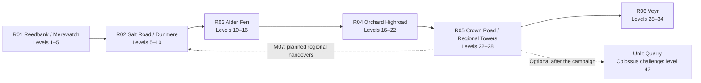

# Avel: world, enemies, and bosses

Content design for [The Road Beyond the Bells](story.md), aligned with the [combat brief](combat-design.md) and [side quests](side-quests.md). These are original regions and creatures. The level bands and stronger variants are original balance proposals. The first region is playable in the demo; later regions remain content designs.

## The connected world

Avel's remaining towns lie along an old commercial road, with marsh routes that bypass Crown checkpoints. Great bells protect populous settlements; small wards shelter isolated camps. Neither kind of protection makes the connecting wilderness harmless. Reopening that route is both the party's journey and the evacuation's practical foundation.

Bands describe the intended party progression through the main route. Ordinary enemies have fixed area-specific values. Returning at a higher level does not upgrade them. Strong forms occupy authored later encounters or clearly marked optional dens; they do not ambush players by replacing familiar early encounters after a level-up.

Daylight reveals footprints, damaged tools, and the names on abandoned houses. At dusk, lamps and nearby ward boundaries become more visible. The Hush can linger inside unlit ruins even during the day. These are atmosphere and authored encounter conditions, not a hidden clock that kills quest NPCs while the player explores menus.

## R01 — Reedbank and Merewatch

**Hub:** Bessa's occupied camp, then the supported shelter reached after its relocation. **Landmarks:** the reed landing, Merewatch's inspection gallery, and the underground binding chamber. Copper pipes, wet timber, painted meal tins, and swallowed warning notes establish the frontier's human scale.

Shallow-water scavengers occupy the bank; neglected maintenance constructs patrol the tower. A few Hush have entered its dark workings. Encounters teach focus fire, armor, and preparing for an announced hit. The first playable uses only this compact expedition and the Brass Bailiff. An optional collapsed culvert becomes a survey site after the camp has safely moved, not during Orren's rescue.

## R02 — The Salt Road and Dunmere

**Hub:** Dunmere's market lodging and refuge hospice. **Landmarks:** the counting house, the impounding toll station, and the abandoned posthouse used in SQ-T2. White salt dust and polished shopfronts conceal the transport traffic behind the bell precinct.

Caravan scavengers follow the road; automated customs machines hold deserted depots. Hush gather in wax-lined storage rooms where bell shipments once waited. Enemy combinations introduce a fragile support caster protected by a durable front enemy. A disused weighbridge beyond the settled road provides the optional hunt site once the holding yard is freed.

## R03 — Alder Fen

**Hub:** Sen's warded village and training yard. **Landmarks:** plankwalk crossings, the flooded granary, and the two-refuge shelter trial. Kitchens and watch schedules share wall space with ward diagrams; residents already possess the knowledge the party needs.

Flooded foundations shelter armored scavengers, spiders, and cold Hush. Their attacks test recovery and elemental choices. The granary fight opens existing food stores and access routes. Clearing a building does not instantly drain the whole marsh. The optional moonpool boardwalk branches from a functioning shelter after the granary is secured.

## R04 — The Orchard Highroad

**Hub:** the restored orchard storehouse and roadside refuge. **Landmarks:** contaminated terraces, the old nursery of SQ-R3, and a ridge rest house overlooking the future evacuation route. Rusted pruning tools and blackened irrigation channels show the cost of bell waste outside the town walls.

Hush imitate animal shapes among thorn roots; scavengers use the resulting cover. Poison pressures the expedition's supplies without becoming unavoidable damage in every encounter. The main Ashroot Hart clearance secures the route; the Briar Widow occupies a separate optional terrace. An amber-glass clearing becomes the region's marked hunt site afterward.

## R05 — The Crown Road and Regional Towers

**Hub:** Bessa's handover depot, supported by Halden's volunteers and civilian ward crews. **Landmarks:** the disused watchhouse of SQ-M2, a regional feeder approach, and the old quarry. Cut-stone roads alternate with broken bridges and lines of people carrying household possessions.

The region tests mixed formations and preparation rather than introducing unexplained level scaling. Decommissioning towers does not despawn every surviving creature outside them. Civilian evacuation routes stay distinct from optional survey tracks. The quarry's deepest sealed approach opens only after the campaign, explicitly warning of a level-42 challenge.

## R06 — Veyr

**Hub:** Iona's refuge and Neri's kitchen distribution point before the final operation; an allied receiving shelter afterward. **Landmarks:** the intake ward, the theater of SQ-R4, and the service passage leading to the Heart Bell. Bright public squares sit above unlit maintenance streets.

Hush and defensive constructs dominate combat; ordinary residents are not random-encounter targets. The Night Choir guards the service route. Vale's armor and the Heart Bell form the final confrontation. Optional surveys do not interrupt that urgent operation: the Starless Cantor's sealed transept becomes accessible after the campaign, while the world remains inhabited by residual Hush.

## Ordinary enemies: 24 authored entries

`W` means weakness; `R` means resistance. Fire, frost, and lightning are proposed damage tags. Armor is physical mitigation, not an additional magic element. Resisting a status does not automatically mean resisting its associated attack's damage. The exact multipliers belong to combat balancing.

| ID / enemy | Family and role | Visible tell and useful answer | W / R |
| --- | --- | --- | --- |
| R01_E1 — Mud Reedback | REEDBACK; armored bank scavenger. | Pulls into its shell before a shove; use magic or guard. | W lightning; R frost. |
| R01_E2 — Reed Hound | HOUND; fragile pack attacker. | Lowers its head before a lunge; remove a pack member early. | W frost; no elemental R. |
| R01_E3 — Soot Wisp | WISP; low-health swarm. | Gathers sparks before spreading; area damage saves later actions. | W frost; R fire. |
| R01_E4 — Brass Mite | SENTINEL; small repair automaton. | Opens a vent to ready a piercing jab; strike while exposed. | W lightning; R poison status. |
| R02_E1 — Salt Jackal | HOUND; finisher targeting wounded heroes. | Watches the lowest-HP hero before its next attack; heal or guard. | W frost; no elemental R. |
| R02_E2 — Coin Moth | WISP; evasive swarm. | Reflective wings flare before a dust burst; favor reliable magic. | W fire; R frost. |
| R02_E3 — Ledger Sentinel | SENTINEL; armored support blocker. | Locks its shutters while supporting a caster; attack the caster first. | W lightning; R poison status. |
| R02_E4 — Wax Cantor | CANTOR; fragile magical support. | Inflates a wax throat before a silence attempt; prioritize or recover. | W fire; R frost. |
| R03_E1 — Reed Widow | WIDOW; poison specialist. | Raises its marked forelegs before a venom strike; protect or cure. | W fire; R poison status. |
| R03_E2 — Bog Reedback | REEDBACK; durable pressure. | Plants its shell before a sweeping ram; guard the announced strike. | W lightning; R frost. |
| R03_E3 — Mourning Cantor | CANTOR; sleep support. | A visible throat-ring brightens before a lullaby; defeat it early. | W fire; R frost. |
| R03_E4 — Fen Hound | HOUND; pack pressure behind a blocker. | Circles a guarded hero, then chooses another; avoid relying on one tank. | W frost; no elemental R. |
| R04_E1 — Thorn Spinner | WIDOW; poison and single-target pressure. | Weaves a dark knot before firing; use protection or focus fire. | W fire; R poison status. |
| R04_E2 — Cinder Hart | HART; sturdy announced attacker. | Antlers brighten before a charge; guard, then exploit its recovery. | W frost; R fire. |
| R04_E3 — Orchard Wisp | WISP; clustered magical damage. | Draws sparks toward a root before bursting; use area attacks. | W frost; R fire. |
| R04_E4 — Husk Hound | HOUND; aggressive flanker. | Scrapes the ground before attacking a wounded target; stabilize HP. | W frost; R poison status. |
| R05_E1 — Road Bellwarden | SENTINEL; armored protector. | Turns its shield toward an ally before covering it; change targets or use magic. | W lightning; R poison status. |
| R05_E2 — Mirror Reedback | REEDBACK; slow armored attacker. | Raises reflective shell plates before a physical slam; guard its strike. | W lightning; R frost. |
| R05_E3 — Gallows Cantor | CANTOR; silence support. | Its hanging throat-loop glows before the chant; keep recovery available. | W fire; R frost. |
| R05_E4 — Antler Pilgrim | HART; sustained physical pressure. | Kneels before a heavy sweep; preserve protection for the telegraphed round. | W frost; R fire. |
| R06_E1 — Crown Sentinel | SENTINEL; late armored blocker. | Opens shoulder vents before its shield slam; attack during recovery. | W lightning; R poison status. |
| R06_E2 — Ink Widow | WIDOW; precision status threat. | Spreads its striped legs before marking a target; prioritize or guard. | W fire; R poison status. |
| R06_E3 — Glass Wisp | WISP; brittle magical attacker. | Prisms align before a party-wide pulse; reduce the group quickly. | W frost; R fire. |
| R06_E4 — Choir Shade | CANTOR; late magical support. | Its throat-rings light in sequence; interrupt its support by defeating it. | W fire; R frost. |

Families deliberately recur: Mud → Bog → Mirror Reedback, Reed → Salt → Fen → Husk Hound, and Brass Mite → Ledger Sentinel → Road Bellwarden → Crown Sentinel preserve recognizable silhouettes. New regional entries can change roles, but the bestiary explains those changes. A familiar shape should offer useful knowledge, not conceal an arbitrary immunity reversal.

## Stronger color variants

Each ordinary entry can have **Base**, **Ashen**, and **Crested** ranks. Rank is meaningful within the same enemy entry; a Crested Mud Reedback is not automatically stronger than a late-region base Crown Sentinel.

| Rank | Color treatment | Additional identification | Encounter placement |
| --- | --- | --- | --- |
| Base | Habitat-colored green, brown, brass, or soot. | Ordinary name and one rank pip. | The entry's normal authored formations. |
| Ashen | Cooler slate palette with pale stripes. | `Ashen` prefix, two pips, visible stripe pattern. | A later local section or a marked survey formation. |
| Crested | Deep violet accents and a contrasting crest. | `Crested` prefix, three pips, altered silhouette detail. | A clearly marked optional den or a later authored encounter. |

Use stronger stats and a readable variation of the established move; do not grant an unseen extra turn merely because the sprite changed color. Rank is independent of rarity. Named rare enemies use a separate diamond icon, their own markings, and explicit bestiary text. Color alone never carries the information, and item-rarity colors do not redefine enemy strength.

## Six rare enemies and regional equipment

These hunts are optional, fixed-strength encounters. Their caches contain reclaimed regional equipment or materials carried from old depots, not human memories. Each victory supplies the corresponding area's equipment cache; the separate loot rules determine selection and duplicate protection. Main bosses are tuned for ordinary purchased and quest equipment.

| ID / named rare | Fixed level / family | Recognition and encounter identity | Hunt area / cache |
| --- | --- | --- | --- |
| R01_RARE — Silver Reedback | 7 / REEDBACK | Silver shell with dark chevrons; announces a powerful shell shove. | Collapsed culvert, after Reedbank relocates / R01 cache. |
| R02_RARE — Coinveil Jackal | 12 / HOUND | Pale muzzle and coin-shaped flank spots; alternates feints and a committed lunge. | Abandoned weighbridge / R02 cache. |
| R03_RARE — Moonlace Widow | 18 / WIDOW | White web-pattern abdomen and crescent legs; makes its venom target visible. | Moonpool boardwalk / R03 cache. |
| R04_RARE — Amberglass Hart | 24 / HART | Translucent amber antlers and a split crown; announces a sweeping charge. | Cleared orchard's optional glass clearing / R04 cache. |
| R05_RARE — Ivory Bellwarden | 30 / SENTINEL | Ivory plates with black handprints; exposes its core after a defended assault. | Decommissioned tower's outer survey court / R05 cache. |
| R06_RARE — Starless Cantor | 36 / CANTOR | Black-violet throat with white rings; alternating chants reveal recovery windows. | Sealed transept, after the campaign / R06 cache. |

No hunt can delay an unprepared civilian convoy. Access begins after the local rescue or clearance, during supported-shelter downtime. Rare equipment offers optional builds and collection goals; it never unlocks a required story command or a viable ending.

## Ten boss encounters

Rewards listed here are guaranteed salvage concepts, not random boss-drop requirements. Rescued people, evidence, and safe passage remain main-story outcomes independent of equipment. Numerical statistics and item names are assigned in the item catalog.

| ID / boss | Place and purpose | Telegraph and answer | Guaranteed noncritical reward concept |
| --- | --- | --- | --- |
| B_R01_BAILIFF — Brass Bailiff | Merewatch; break Orren's external binding frame. | Hammer rises with a warning note before a heavy strike; guard, then attack joints during recovery. Orren's body is never a combat target. | Broken frame's usable fittings for a modest defensive upgrade. |
| B_R02_TOLL — Toll Collector | Dunmere holding yard; disable the impounding machine. | Shutters rotate between protection and an exposed mechanism; prepare during the armored round and strike the opening. No captive is inside it. | Reclaimed customs tool or equipment voucher. |
| B_R03_SILT — Silt Crown | Flooded granary; clear a Hush growth blocking the existing store rooms. | Its floating debris forms a crown before a sweeping surge; guard, then use fire against its exposed growth. | Sealed quartermaster supplies recovered after clearance. |
| B_R04_HART — Ashroot Hart | Orchard route; remove the contaminated antlered growth. | Roots darken before a poison attack; keep recovery ready and exploit the pause after a charge. | Clean storehouse equipment, not instant crops or restored soil. |
| B_R05_CENSER — Gate-Censer | Regional feeder approach; remove a defensive construct before rescue teams enter. | Closes its armored bowl before releasing a silencing chime; use physical attackers and recovery supplies, then attack its exposed stem. | Retired service equipment salvaged during the handover. |
| B_R06_CHOIR — Night Choir | Final service passage; three Hush protect the stairwell. | Throat-rings show the next chant; focus one singer while reserving protection for party damage and recovery for silence. | A rear-guard recovery parcel before the engine approach. |
| B_R06_VALE — Vale's Command Armor | Central engine, first confrontation; extract Vale alive. | Armor braces before a crushing order; guard and break external control braces. Winning frees a living enemy for judgment. | The encounter's progression outcome; no equipment awarded from Vale's person. |
| B_R06_HEART — Heart Bell | Central engine, final confrontation; stop the last active feeder. | Resonance vanes visibly align before its strongest pulse; guard and conserve recovery through shield cycles. | A post-campaign salvage choice and commemorative keepsake, never a prerequisite to victory. |
| B_R04_WIDOW — Briar Widow | Optional terrace in SQ-R3; recover Jessa's graft. | Snapped stems and venom marks introduce its raised-leg venom tell; protect the marked hero and cure poison. | Jessa's finite antitoxin parcel and fruitwood token. |
| B_R05_COLOSSUS — Unlit Colossus | Optional level-42 quarry challenge after the story. A discarded testing construct, not the fog's secret creator. | Quarry lamps outline a raised drill arm before an immense slam; prepare protection and exploit the long reset. | Distinctive equipment appearance and a sidegrade salvage choice. |

## Encounter and story safeguards

Mix compatible roles: a caster behind a blocker, a fragile swarm that rewards area magic, or a poison specialist that rewards preparation. Avoid stacking every disabling status in an ordinary formation. Stronger variants preserve established attack tells. Bosses create preparation windows instead of hiding unavoidable party wipes behind a new color.

The end of the story stops new bell waste, not every existing monster. Revisited wilderness can therefore retain fixed encounters, while cleared quest rooms stay cleared and safer public routes reflect the party's work. Hunts and the Colossus remain optional exploration; neither extends the original first-playable scope nor changes the campaign's humane ending.
